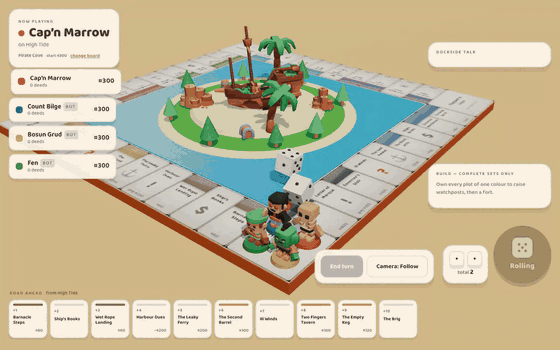
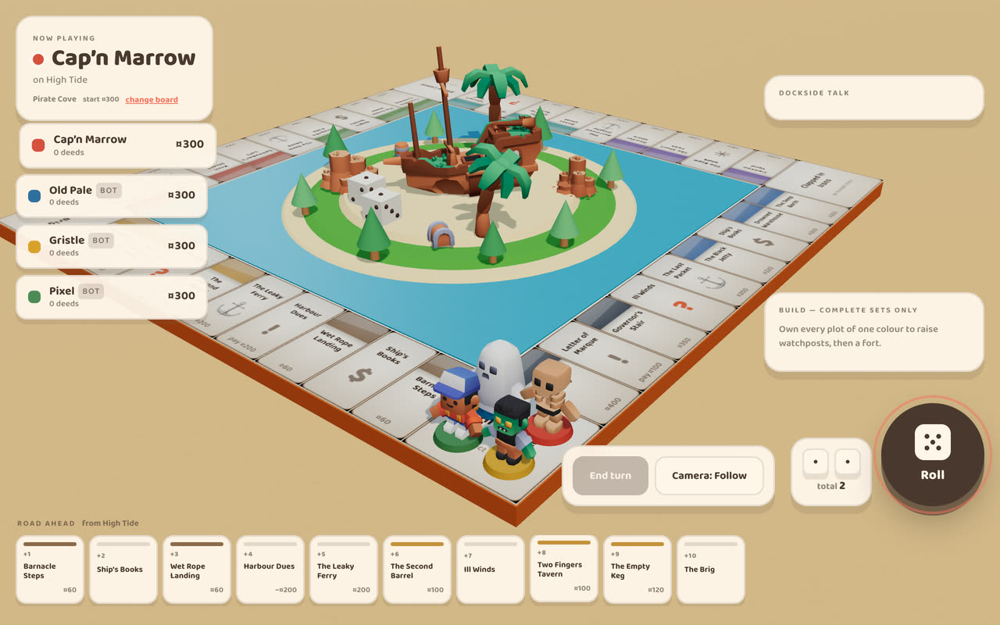
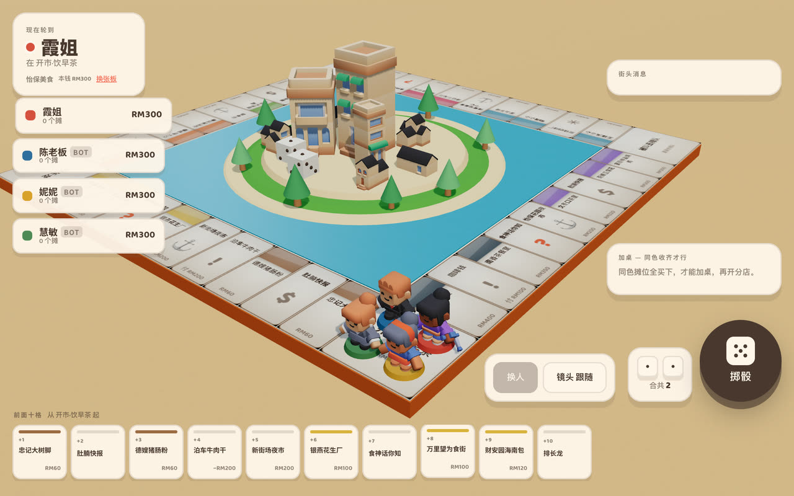
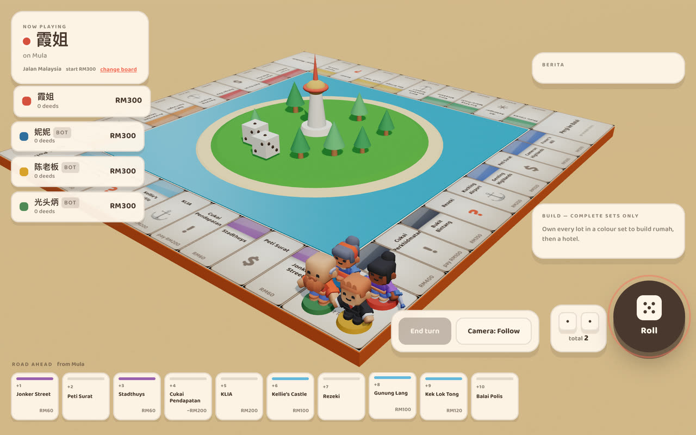
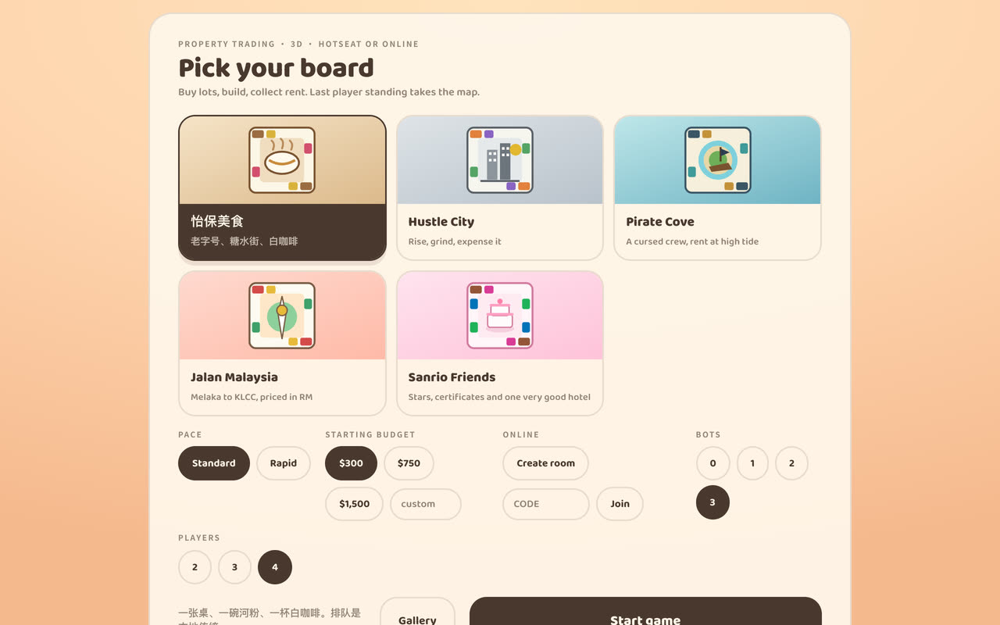
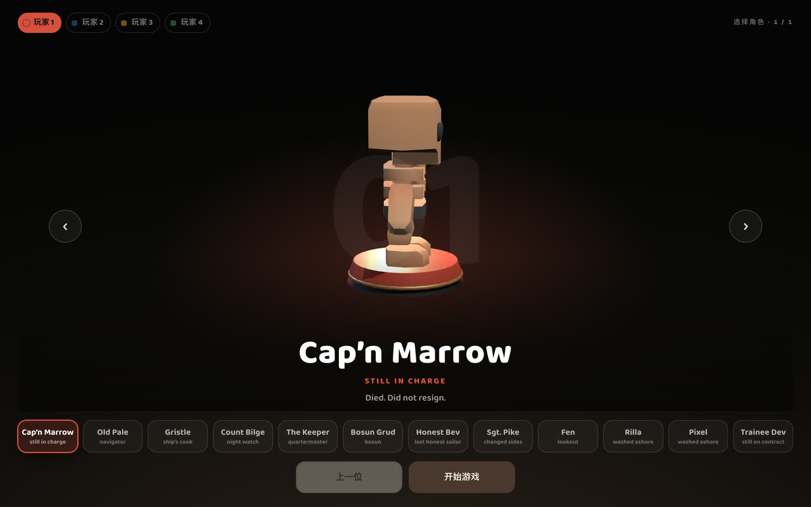
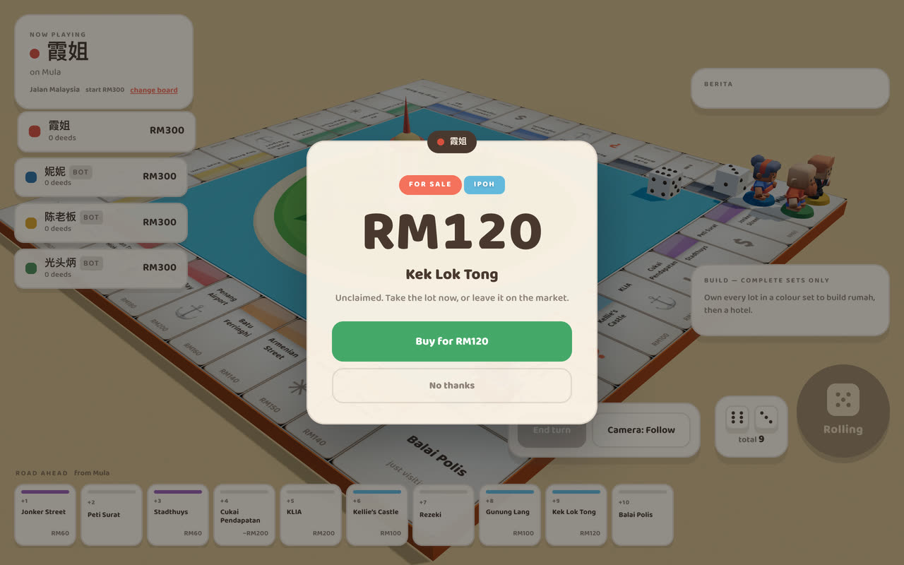
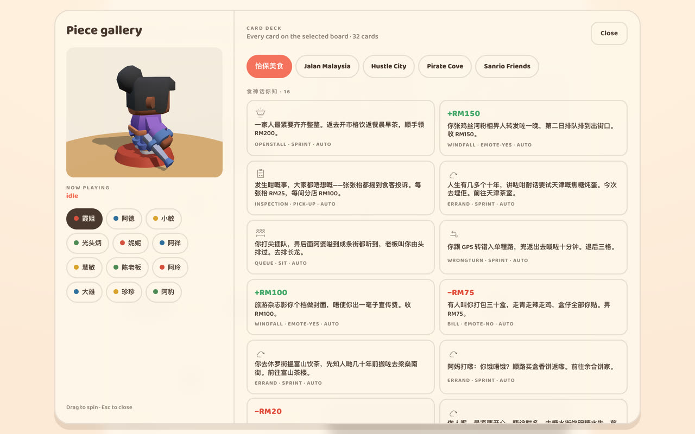

<p align="center">
  <a href="https://shibainu0817.github.io/3D-monopoly/"></a>
</p>

<h1 align="center">Landlord Island</h1>
<p align="center"><i>The free 3D Monopoly alternative: buy lots, build, collect rent. Last player standing takes the map.</i></p>

<p align="center">
  <a href="https://shibainu0817.github.io/3D-monopoly/"></a>
</p>

Landlord Island is a property-trading board game in 3D, played in the browser on a phone, tablet or computer.
Pick a board, pick a character, and roll: buy the lots you land on, finish colour sets, build them up and charge rent until everyone else is broke.
Play with friends on one device, against bots, or online with each player on their own phone.

<table>
  <tr>
    <td colspan="2"></td>
  </tr>
  <tr>
    <td width="50%"></td>
    <td width="50%"></td>
  </tr>
  <tr>
    <td></td>
    <td></td>
  </tr>
  <tr>
    <td></td>
    <td></td>
  </tr>
</table>

## The boards

| Board | Setting |
|---|---|
| **怡保美食** | Ipoh's food streets, in Chinese: 老字号, 糖水街 and white coffee. Queueing is a local tradition. |
| **Jalan Malaysia** | Melaka to KLCC, priced in RM: states, highlands and night markets. |
| **Hustle City** | Rise, grind, expense it. Rents are due Monday. |
| **Pirate Cove** | A cursed crew, a sinking market, and rent due at high tide. |

Each board has its own lots, prices, cards, pieces and island in the middle.

## How to play

| | |
|---|---|
| **Set up** | Pick a board, a pace, a starting budget (or type your own), 2–4 players and up to 3 bots, then **Start game**. Each player picks a character. |
| **Roll** | Roll two dice and move. The camera follows your piece; switch it to **Overview** to see the whole board. |
| **Buy** | Land on an unclaimed lot and buy it, or move along. Others pay you rent when they land on yours. |
| **Build** | Own a whole colour set to build on it, evenly, up to a hotel. Rent climbs with every building. |
| **Survive** | Cards, taxes and the board's own "jail" (on 怡保美食, a long queue) get in the way. Run out of money and you're out. |
| **Pace** | **Standard**, or **Rapid**: the salary for passing Start shrinks by 50 each lap, so games end sooner. |
| **Online** | **Create room** gives you a code. Others type it under **Join** on their own device and pick their characters at the same time. |

Games save on the device: **Resume** picks up where you left off.

---

# For developers

## Folders

```
3D-monopoly/
├─ index.html              the whole game page: menu, HUD, sheets and styles
├─ game/
│  ├─ main.js              the game loop, menu and UI
│  ├─ engine.js            the rules: moves, buying, rent, building, cards, bankruptcy
│  ├─ data.js              every board: lots, prices, colours, cards, labels and look
│  ├─ board3d.js           the 3D board, pieces, buildings and dice (Three.js)
│  ├─ select.js            the character select
│  ├─ gallery.js           the piece and card gallery
│  └─ net-mqtt.js          online play: rooms over public MQTT brokers, inputs replayed in lockstep
├─ assets/                 3D models (.glb): Kenney packs (CC0) and the board-specific casts
├─ tools/
│  ├─ obj2glb.py           turns a character model into a riggable GLB
│  └─ shrine.py            builds a low-poly diorama as a GLB
├─ media/                  teaser and screenshots for this README
├─ screens/                design references
├─ LICENSE                 MIT, for the code
└─ NOTICE                  what MIT doesn't cover: the 3D models, the boards' content and media
```

## Run and deploy

There is no build step: the page loads Three.js and MQTT.js from unpkg through an import map, and the game as plain ES modules.

```bash
python3 -m http.server 8000      # then open http://localhost:8000
```

Opening `index.html` straight from disk doesn't work, because browsers block ES modules from `file://`.

- **Online play** needs no server of your own. Rooms run over public MQTT brokers (HiveMQ, Mosquitto, EMQX, tried in that order). They're free community services with no uptime guarantee, and anyone can read the messages, so keep nothing private in them.
- **Deploy:** GitHub Pages serves `main` at https://shibainu0817.github.io/3D-monopoly/. Push to `main` and it updates. Pages caches for about 10 minutes, so two devices can briefly run different versions; `BUILD` in `game/net-mqtt.js` makes them refuse to join each other rather than fail silently. Bump it whenever the online message format changes.
- **New board:** add an entry to `BOARDS` in `game/data.js` (lots, prices, colours, cards, labels, `look`). The menu, engine and 3D board all read from it.

Code: MIT. The 3D models keep their own licences (mostly Kenney, CC0), and the boards' content and media are all rights reserved. See [LICENSE](LICENSE) and [NOTICE](NOTICE).
